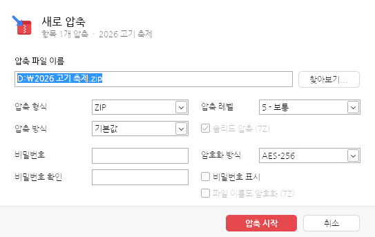
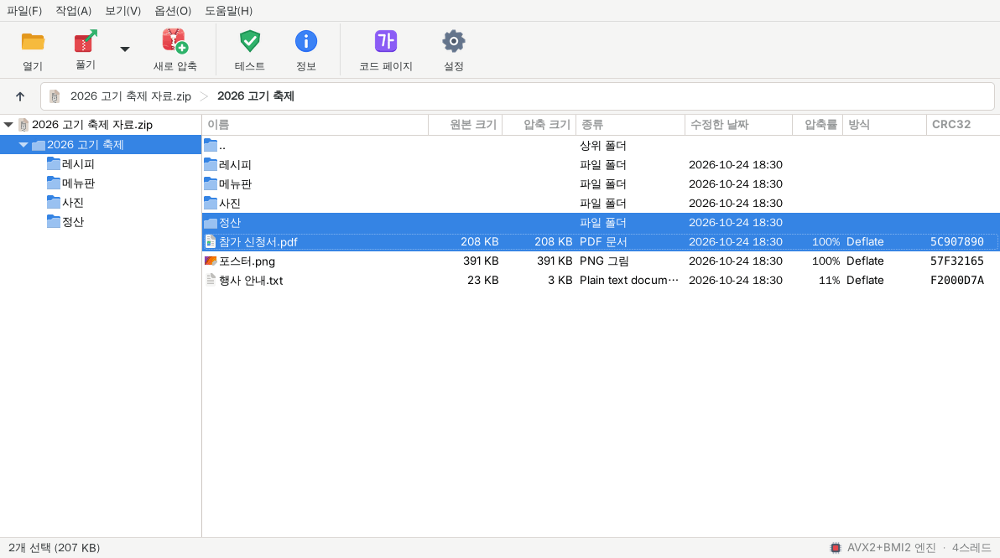
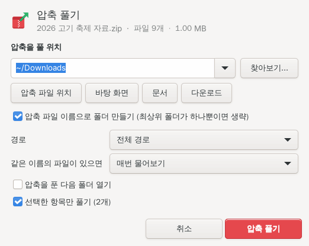

<p align="center"></p>

<h1 align="center">고깃ZIP (GogitZIP)</h1>

<p align="center">C로 직접 짠 가볍고 빠른 압축 프로그램 · Windows 2000 ~ 11 · macOS · Linux</p>

<p align="center">
  <a href="https://github.com/NiSeullent/Butcherar/releases/latest"><b>내려받기</b></a> ·
  <a href="https://niseullent.github.io/Butcherar/">공식 홈페이지</a> ·
  <a href="#지원-형식">지원 형식</a> ·
  <a href="#빌드">빌드</a> ·
  <a href="#english">English</a>
</p>


고깃ZIP은 반디집이나 V3 Zip 같은 한국식 화면을 가진 압축 프로그램입니다. **<!-- gen:nread -->52<!-- /gen:nread -->가지 형식**을
열고 풀며, ZIP · 7z · TAR · ISO 같은 압축 파일을 새로 만듭니다. 압축 엔진과 형식 처리는 모두 C로 직접 짰고
(외부 압축 라이브러리 없음), 같은 엔진이 Windows · macOS · Linux 앱과 명령줄 도구에 들어갑니다.

- **Windows**: C 런타임(msvcrt) 없이 Win32 API만 부르는 실행 파일 하나(약 1.4MB). Windows 2000부터 11까지 같은 파일이 돌아갑니다.
- **macOS**: Cocoa 앱 하나로 Intel(10.13 이상)과 Apple silicon(11 이상)을 모두 지원합니다.
- **Linux**: GTK 3 앱과 명령줄 도구. x86-64 · ARM64용 설치 패키지와 .deb가 있습니다.
- **속도**: 실행할 때 CPU를 확인해서 x86은 i586부터 AVX2까지 7단계, ARM64는 NEON · CRC32 · AES · SHA 명령 중 쓸 수 있는 가장 빠른 엔진을 고릅니다.

## 내려받기

[최신 릴리스](https://github.com/NiSeullent/Butcherar/releases/latest)에서 받으세요.

| 운영체제 | 최소 버전 | 파일 |
|---|---|---|
| Windows 64비트 | XP x64 / Vista x64 이상 (7 · 8 · 10 · 11) | `GogitZip64.exe` |
| Windows 32비트 | Windows 2000 이상, Pentium 이상 CPU | `GogitZip.exe` |
| macOS | 10.13 High Sierra (Intel), 11 Big Sur (Apple silicon) | `GogitZIP-mac.dmg` |
| Linux x86-64 | glibc 2.35 (Ubuntu 22.04, Debian 12 …), GTK 3 | `GogitZIP-2.0.0-linux-x86_64.tar.gz`, `gogitzip_2.0.0_amd64.deb` |
| Linux ARM64 | glibc 2.35, GTK 3 | `GogitZIP-2.0.0-linux-aarch64.tar.gz`, `gogitzip_2.0.0_arm64.deb` |

- Windows는 설치 없이 실행합니다. 설정은 `HKCU\Software\GogitZIP`에만 저장하고, 탐색기 메뉴도 관리자 권한 없이 `HKCU`에 등록합니다.
- macOS는 dmg 안의 GogitZIP을 ‘응용 프로그램’ 폴더로 옮기면 됩니다.
- Linux는 `sudo apt install ./gogitzip_2.0.0_amd64.deb`, 또는 `.tar.gz`를 풀고 `./install.sh`(내 계정의 `~/.local`, 모든 사용자는 `sudo ./install.sh --system`).
- 코드 서명이 없어서 처음 실행할 때 Windows SmartScreen(**추가 정보 → 실행**)이나 macOS Gatekeeper(앱을 **오른쪽 클릭 → 열기**, 또는 `xattr -dr com.apple.quarantine /Applications/GogitZIP.app`) 경고가 나올 수 있습니다. 릴리스의 `SHA256SUMS.txt`로 파일을 확인할 수 있습니다.

## 기능

| 구분 | 내용 |
|---|---|
| 읽기 | <!-- gen:nread -->52<!-- /gen:nread -->가지 형식: 압축 파일, 설치 파일·실행 파일, 디스크 이미지, 파일 시스템 ([아래 표](#지원-형식)). 압축된 TAR는 한 번에, 압축 파일 안의 압축 파일과 디스크 이미지 안의 파일 시스템은 두 번 눌러 바로 |
| 만들기 | ZIP, 7z, TAR, TAR.GZ · TAR.BZ2 · TAR.XZ · TAR.ZST, GZ · BZ2 · XZ · ZST, ISO (Deflate, BZip2, LZMA, LZMA2, PPMd, Zstandard, 실행 파일용 BCJ · ARM64 필터) |
| 암호 | ZIP WinZip AES-256 · ZipCrypto, 7z AES-256과 파일 이름 암호화 (만들기 · 풀기). RAR 3 · 5, 알집 EGG(AES · LEA) · ALZ, ARJ 암호 풀기 |
| 한국 형식 | 알집 **ALZ · EGG** (분할, 솔리드, 암호), CP949 / UTF-8 이름 자동 감지, macOS 자소 분리(NFD) 이름 합치기, 코드페이지 직접 선택 |
| 속도 | x86 7단계(i586 · MMX · SSE · SSE2 · SSE4.1 · AVX · AVX2) + PCLMULQDQ / VPCLMULQDQ CRC32, AES-NI / VAES, SHA-NI. ARM64 NEON · CRC32 · PMULL · AES · SHA. 여러 파일을 CPU 코어 수만큼 동시에 |
| 안전 | 대상 폴더 밖으로 나가는 경로(Zip Slip)와 링크 차단, Windows 예약 이름 처리, 모든 파일 CRC · 해시 검사, 손상 파일 자동 삭제, 압축 폭탄 · 손상 파일 퍼징 테스트, 인터넷에서 받은 파일의 출처 표시(Mark-of-the-Web) 전달 |
| 화면 | 도구 모음, 경로 표시줄, 폴더 트리, 파일 목록, 시작 화면, 진행률(일시 정지 · 취소), 비밀번호 · 덮어쓰기 · 압축 · 설정 · CPU 벤치마크 창 |
| 통합 | Windows 탐색기 오른쪽 클릭 메뉴(풀기 · 압축하기) · 연결 프로그램, macOS Finder 서비스 · 문서 형식, Linux 프로그램 메뉴 · MIME 형식 · Nautilus/Dolphin/Thunar 메뉴, 끌어다 놓기, 명령줄 |

## 지원 형식

읽기 <!-- gen:nread -->52<!-- /gen:nread -->가지, 만들기 <!-- gen:nwrite -->12<!-- /gen:nwrite -->가지. 아래 표는 프로그램의 형식 목록(`src/fmt`의 `GZ_FORMAT` / `GZ_WRITER`)에서
`python3 tools/gen_docs.py`로 만들며, `make test`가 표와 코드가 맞는지 확인합니다.
<!-- gen:formats-md -->
#### 압축 파일 (24)

| 형식 | 확장자 | 읽기 | 만들기 |
|---|---|---|---|
| **7z** | 7z | ✓ LZMA·LZMA2·PPMd·BZip2·Deflate64·Zstd·LZ4, BCJ·BCJ2 필터, AES-256, 헤더 암호화 | ✓ 저장 · Deflate · BZip2 · LZMA · LZMA2 · PPMd + AES-256, BCJ·ARM64 필터, 파일 이름 암호화 (.7z) |
| **ZIP** | zip zipx jar war ear apk xpi odt ods odp docx xlsx pptx epub ipa appx nupkg whl z01 | ✓ Deflate·Deflate64·BZip2·LZMA·PPMd·Zstd·XZ·Implode·Shrink, ZIP64, WinZip AES·ZipCrypto, 분할(.z01), SFX | ✓ 저장 · Deflate · BZip2 · LZMA · PPMd + ZipCrypto · AES-256, ZIP64 (.zip) |
| **RAR5** | rar exe | ✓ RAR 5 ~ 7, 솔리드, 볼륨, AES-256 암호·헤더 암호화, BLAKE2sp | — |
| **RAR** | rar r00 exe | ✓ RAR 1.4 ~ 4.x, 솔리드, 볼륨, AES-128 암호·헤더 암호화 | — |
| **ALZ** | alz a00 | ✓ 알집 4 ~ 7, 분할(.a00), ZipCrypto 암호, 한글 이름(CP949) | — |
| **EGG** | egg | ✓ 알집 8 이상, 솔리드, 분할, AZO·LZMA·BZip2·Deflate, AES·LEA 암호 | — |
| **TAR** | tar | ✓ ustar·GNU·pax·v7, 긴 이름과 링크, 압축된 TAR(.tar.gz 등)도 바로 | ✓ ustar·pax: 긴 이름·링크·권한 (.tar) |
| **GZIP** | gz gzip tgz taz tpz | ✓ 여러 멤버, .tar.gz·.tgz | ✓ 저장 · Deflate (.gz, .tar.gz) |
| **BZIP2** | bz2 bzip2 tbz2 tbz | ✓ 여러 스트림, .tar.bz2 | ✓ BZip2 (.bz2, .tar.bz2) |
| **XZ** | xz txz | ✓ BCJ·Delta 필터, CRC-64·SHA-256 검사, .tar.xz | ✓ 저장 · LZMA2 (.xz, .tar.xz) |
| **ZSTD** | zst tzst zstd | ✓ Zstandard, .tar.zst | ✓ 저장 · Zstandard (.zst, .tar.zst) |
| **LZMA** | lzma tlz | ✓ LZMA-alone (.lzma) | — |
| **LZIP** | lz tlz | ✓ lzip (.lz) | — |
| **LZ4** | lz4 tlz4 | ✓ LZ4 프레임 (.lz4) | — |
| **LZO** | lzo tzo | ✓ lzop (.lzo) | — |
| **Z** | z taz | ✓ Unix compress (.Z) | — |
| **CAB** | cab | ✓ MSZIP·Quantum·LZX, 여러 CAB에 걸친 파일, 실행 파일 속 CAB | — |
| **ARJ** | arj | ✓ ARJ 0.x ~ 3.x, 볼륨, SFX, 암호(XOR) | — |
| **LZH / LHA** | lzh lha lzs | ✓ lh0 ~ lh7·lzs·lz5, 헤더 레벨 0 ~ 3, SFX | — |
| **CPIO** | cpio | ✓ newc·crc·odc·바이너리, initramfs | — |
| **CHM** | chm chi chq chw | ✓ Windows 도움말 (LZX) | — |
| **SZDD / KWAJ** | ex_ dl_ sy_ in_ hl_ tx_ cp_ ch_ bm_ fo_ dr_ ov_ 38_ | ✓ MS compress.exe (SETUP.EX_ 등) | — |
| **PBZX** | pbzx | ✓ macOS 업데이트·설치 페이로드 | — |
| **분할 파일** | 001 | ✓ 7-Zip·HJSplit 분할 파일(.001)을 이어서 열기 | — |

#### 설치 파일·실행 파일 (9)

| 형식 | 확장자 | 읽기 | 만들기 |
|---|---|---|---|
| **NSIS** | exe nsis | ✓ NSIS 2 ~ 3 설치 파일 (zlib·BZip2·LZMA, 솔리드) | — |
| **Inno Setup** | exe bin | ✓ Inno Setup 1.3 ~ 7.x 설치 파일, 암호 | — |
| **MSI / OLE** | msi msp mst msm doc xls ppt msg | ✓ Windows Installer(.msi·.msp·.msm), Office 97 ~ 2003 문서, Outlook .msg | — |
| **XAR** | xar pkg xip mpkg | ✓ macOS 설치 패키지(.pkg), .xip | — |
| **RPM** | rpm | ✓ RPM 패키지 (gzip·bzip2·xz·zstd 페이로드) | — |
| **AR** | a ar deb lib udeb ddeb ipk | ✓ Debian 패키지(.deb), 정적 라이브러리(.a·.lib) | — |
| **PE** | exe dll sys ocx cpl scr efi mui drv ax acm tsp te | ✓ Windows 실행 파일·DLL: 섹션, 리소스(아이콘·버전·문자열), 덧붙은 데이터 | — |
| **ELF** | elf so o ko axf prx mod | ✓ Linux 실행 파일·라이브러리: 섹션, 세그먼트 | — |
| **Mach-O** | dylib bundle macho o | ✓ macOS 실행 파일, 유니버설 바이너리 | — |

#### 디스크 이미지 (11)

| 형식 | 확장자 | 읽기 | 만들기 |
|---|---|---|---|
| **ISO** | iso img | ✓ ISO 9660·Joliet·Rock Ridge, El Torito 부트 이미지, 4GB 넘는 파일 | ✓ Joliet·Rock Ridge (.iso) |
| **UDF** | udf iso img | ✓ UDF 1.02 ~ 2.60 (DVD·Blu-ray) | — |
| **DMG** | dmg img smi | ✓ macOS 디스크 이미지 (ADC·zlib·bzip2·LZFSE·XZ) | — |
| **WIM** | wim swm esd | ✓ Windows 이미지 WIM·ESD·SWM (XPRESS·LZX·LZMS) | — |
| **VHD** | vhd | ✓ Virtual PC·Hyper-V (고정·동적·차이 디스크) | — |
| **VHDX** | vhdx avhdx | ✓ Hyper-V VHDX | — |
| **VMDK** | vmdk | ✓ VMware (sparse·streamOptimized·flat) | — |
| **VDI** | vdi | ✓ VirtualBox | — |
| **QCOW / QCOW2** | qcow2 qcow qcow2c img | ✓ QEMU (압축 클러스터 포함) | — |
| **Sparse** | simg img | ✓ Android sparse 이미지 | — |
| **MBR / GPT** | mbr gpt img bin raw dsk hdd | ✓ 파티션 테이블 MBR·GPT·Apple Partition Map | — |

#### 파일 시스템 (8)

| 형식 | 확장자 | 읽기 | 만들기 |
|---|---|---|---|
| **NTFS** | ntfs img | ✓ 압축·WOF 압축, 대체 데이터 스트림, 링크 | — |
| **FAT** | fat img ima vfd flp | ✓ FAT12·FAT16·FAT32, 긴 이름 | — |
| **exFAT** | exfat img | ✓ exFAT | — |
| **ext2/3/4** | ext ext2 ext3 ext4 img | ✓ ext2·ext3·ext4 (익스텐트, 인라인 데이터) | — |
| **HFS / HFS+** | hfs hfsx hfsplus img | ✓ HFS·HFS+·HFSX, 압축된 파일 | — |
| **APFS** | apfs img | ✓ Apple File System (암호화되지 않은 볼륨) | — |
| **SquashFS** | sqfs squashfs squash sfs snap img | ✓ SquashFS 3.x·4.0 (gzip·lzma·xz·lzo·lz4·zstd) | — |
| **CramFS** | cramfs cram img | ✓ CramFS | — |

<!-- /gen:formats-md -->
## 화면

| Windows: 압축하기 | Windows: 시작 화면 |
|---|---|
|  |  |
| **Linux (GTK 3): 메인 창** | **Linux: 압축 풀기** |
|  |  |

## 명령줄

모든 운영체제에 같은 명령줄 도구 `gogitzip`이 있습니다(macOS: `GogitZIP.app/Contents/Helpers/gogitzip`).

```sh
gogitzip l 자료.zip                       # 목록 (-slt: 자세히)
gogitzip x 자료.7z -o 받은파일             # 경로를 살려서 풀기 (e: 경로 없이)
gogitzip x 자료.alz --smart               # 필요하면 '자료' 폴더를 만들어 풀기
gogitzip t 자료.rar -p 암호                # 검사
gogitzip a 묶음.zip 문서/ 사진/             # 압축하기 (형식은 확장자로: .7z .tar.xz .iso ...)
gogitzip a -mx9 -p 암호 --encrypt-names 비밀.7z 폴더/
gogitzip i                                # 지원 형식과 지금 쓰는 CPU 엔진
gogitzip --help
```

Windows 실행 파일은 탐색기 메뉴가 쓰는 스위치를 받습니다.

```
GogitZip.exe 자료.zip                 압축 파일 열기
GogitZip.exe /smart 자료.zip          '자료' 폴더를 만들어 풀기 (최상위 폴더가 하나면 생략)
GogitZip.exe /here 자료.zip           압축 파일이 있는 곳에 풀기
GogitZip.exe /to D:\받은파일 자료.zip   지정한 폴더에 풀기
GogitZip.exe /extract 자료.zip        압축 풀기 창
GogitZip.exe /test 자료.zip           압축 파일 검사
GogitZip.exe /add 파일 폴더 ...        압축하기 창 (/zip, /7z: 창 없이 "이름.zip" / "이름.7z")
GogitZip.exe /register [/assoc]      탐색기 메뉴 등록 (/assoc: 연결 프로그램도)
GogitZip.exe /unregister             탐색기 통합 제거
GogitZip.exe /bench                  CPU 가속 벤치마크
```

Linux의 `gogitzip-gtk`는 `--extract-here`, `--extract-smart`, `--extract-to DIR`, `--test`, `--compress`를 받습니다([data/linux/README.md](data/linux/README.md)).

## 빌드

C 컴파일러(GCC 또는 clang)와 GNU make만 있으면 됩니다. 외부 라이브러리는 Linux 앱의 GTK 3뿐입니다.

**Windows** (Linux에서 MinGW-w64로 크로스 컴파일, 또는 Windows의 MSYS2)

```sh
sudo apt install gcc-mingw-w64-i686 gcc-mingw-w64-x86-64 binutils-mingw-w64
make            # build/GogitZip.exe (x86, -march=i586, Windows 2000+), build/GogitZip64.exe (x64)
```

`-nostdlib`로 링크하며 진입점과 `memcpy` 같은 함수는 [`src/win/rt.c`](src/win/rt.c)가 제공합니다. Windows 2000에 없는 API(새 폴더 선택 창, 작업 표시줄 진행률 등)는 실행 중에 있을 때만 불러옵니다.

**Linux**

```sh
sudo apt install build-essential pkg-config libgtk-3-dev   # Fedora: gcc make gtk3-devel
make linux                    # build/linux/gogitzip-gtk + build/gogitzip
sudo make install             # /usr/local (PREFIX=, DESTDIR=)
make dist-linux               # build/dist/GogitZIP-<버전>-linux-<CPU>.tar.gz
make deb                      # build/dist/gogitzip_<버전>_<아키텍처>.deb
```

**macOS** (Xcode 명령줄 도구, 자세한 내용은 [docs/BUILD-mac.md](docs/BUILD-mac.md))

```sh
xcode-select --install
make mac        # build/mac/GogitZIP.app (유니버설: x86_64 10.13+, arm64 11+) + build/gogitzip
make dmg        # build/GogitZIP-mac.dmg
```

**테스트**

```sh
make test       # 단위 · 형식 · 앱 테스트 (tests/cases/*.py), 없는 도구를 쓰는 테스트는 건너뜀
make fuzz       # libFuzzer 하네스 (clang)
```

테스트는 7-Zip, xz, zstd, bzip2, xorriso, mksquashfs, makensis 같은 참조 도구로 그때그때 표본을 만들어 바이트 단위로 비교하고,
잘리거나 비트가 뒤집힌 파일로 충돌 · 무한 루프 · 과도한 메모리 사용이 없는지 확인합니다. CI(`.github/workflows/build.yml`)가 쓰는
도구 목록이 그대로 설치 안내입니다. 프로그램 버전은 [`src/core/version.h`](src/core/version.h) 한 곳에만 있습니다.

## 소스 구성

```
src/core/      공용 모델: 스트림, 형식 등록, 이름 해석(코드페이지 · 한글 NFC), CPU 감지와 커널 선택,
               CRC32 · CRC64 · AES · SHA · BLAKE2 (SIMD 판 포함), version.h
src/codec/     압축 코덱: Deflate(64), LZMA/LZMA2, BZip2, PPMd, Zstandard, LZ4, LZX, XPRESS, LZMS,
               RAR 1.5~7, AZO, LZH, Implode ... (풀기와 만들기)
src/fmt/       형식마다 파일 하나 (읽기) + *_write.c (만들기)
src/app/       운영체제 공용 엔진(풀기 · 압축 작업) + 명령줄 도구 gogitzip + UI 문자열
src/win/       Windows 앱 (C 런타임 없음, Windows 2000+)
src/gtk/       Linux GTK 3 앱
src/mac/       macOS Cocoa 앱
src/posix/     Linux · macOS 플랫폼 계층
data/          Linux 실행기 · MIME · 아이콘, macOS Info.plist · 아이콘
res/           Windows 리소스 (아이콘, 매니페스트, 버전 정보, 아이콘 아틀라스)
tests/         gzt 드라이버, run_tests.py, cases/*.py, 드라이버, 표본
tools/         생성기 (형식 등록, 아이콘, Linux · macOS 데이터, 문서 표), Linux 패키지 스크립트
web/           공식 홈페이지
docs/          ARCHITECTURE.md (기여 규칙), BUILD-mac.md
```

새 형식이나 코덱을 더하려면 [docs/ARCHITECTURE.md](docs/ARCHITECTURE.md)를 먼저 읽어 주세요.

## English

**GogitZIP** (고깃ZIP, "meaty ZIP") is a lightweight, fast archive manager written in C, with a Korean-style
interface in the spirit of Bandizip. It opens and extracts **<!-- gen:nread -->52<!-- /gen:nread --> formats** and creates
ZIP, 7z, TAR (plain, .gz, .bz2, .xz, .zst), GZ, BZ2, XZ, ZST and ISO files. All codecs and format parsers are
written from scratch (no compression libraries) and shared by every front end:
<!-- gen:formats-list-en -->
- **Archives** (24): 7z, ZIP, RAR5, RAR, ALZ, EGG, TAR, GZIP, BZIP2, XZ, ZSTD, LZMA, LZIP, LZ4, LZO, Z, CAB, ARJ, LZH / LHA, CPIO, CHM, SZDD / KWAJ, PBZX, Split files
- **Installers & executables** (9): NSIS, Inno Setup, MSI / OLE, XAR, RPM, AR, PE, ELF, Mach-O
- **Disk images** (11): ISO, UDF, DMG, WIM, VHD, VHDX, VMDK, VDI, QCOW / QCOW2, Sparse, MBR / GPT
- **File systems** (8): NTFS, FAT, exFAT, ext2/3/4, HFS / HFS+, APFS, SquashFS, CramFS
<!-- /gen:formats-list-en -->

- **Windows 2000 - 11**: one ~1.4 MB executable without a C runtime (`GogitZip.exe` x86 for Pentium-class CPUs and up, `GogitZip64.exe` x64).
- **macOS 10.13+** (Intel) / **11+** (Apple silicon): one universal `GogitZIP.app` (`GogitZIP-mac.dmg`).
- **Linux** with GTK 3: prebuilt x86-64 and ARM64 packages (`.tar.gz` with `install.sh`, `.deb`) need glibc 2.35+.
- **Encryption**: WinZip AES-256 and ZipCrypto (ZIP), AES-256 with encrypted names (7z); extracts RAR 3/5, EGG (AES/LEA), ALZ and ARJ encrypted archives too.
- **Speed**: kernels are picked at run time: seven x86 tiers from i586 to AVX2 (+PCLMULQDQ/VPCLMULQDQ, AES-NI/VAES, SHA-NI) and ARM64 NEON/CRC32/PMULL/AES/SHA.
- **Korean archives**: ALZ and EGG (ALZip), CP949/UTF-8 name detection, macOS NFD names composed.

Build: `make` (Windows, MinGW-w64), `make linux` / `make dist-linux` / `make deb` (Linux, GTK 3), `make mac` / `make dmg` (macOS), `make test`.
The prebuilt apps are not code-signed: on Windows choose *More info → Run anyway* in SmartScreen; on macOS right-click the app and choose *Open*
(or run `xattr -dr com.apple.quarantine /Applications/GogitZIP.app`).

## 라이선스

MIT. [LICENSE](LICENSE)를 보세요.
