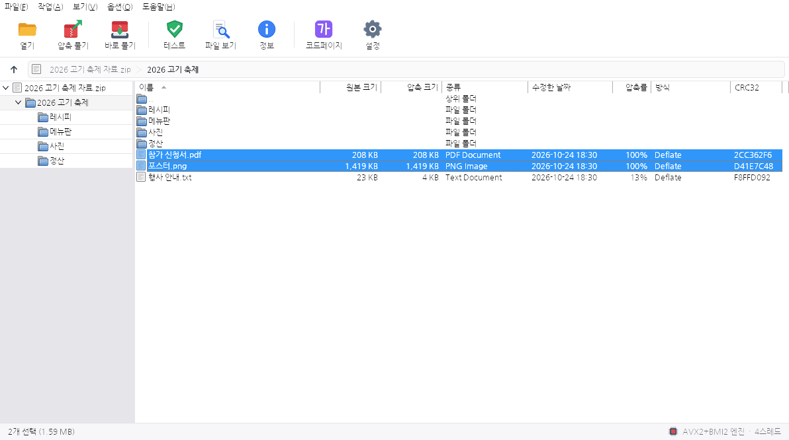
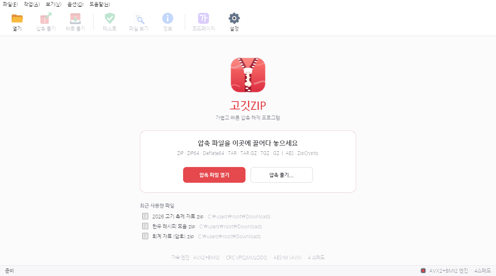
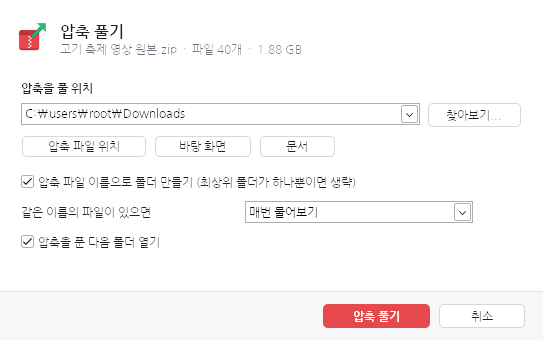
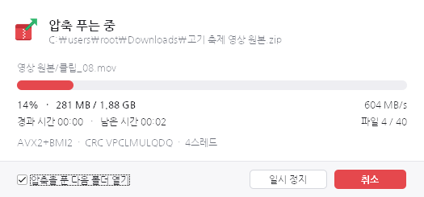
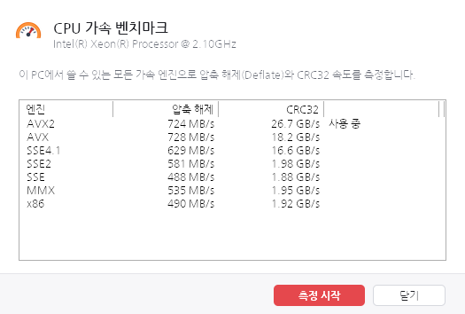

<p align="center"></p>

<h1 align="center">고깃ZIP (GogitZIP)</h1>

<p align="center">C로 만든 400KB짜리 압축 해제 프로그램 · Windows 2000 ~ Windows 11</p>



고깃ZIP은 반디집이나 V3 Zip 같은 한국식 압축 프로그램 화면을 가진 **압축 해제 전용** 프로그램입니다.
C 런타임(msvcrt) 없이 Win32 API만 직접 부르며, 실행 파일 하나(약 400KB)로 Windows 2000부터 Windows 11까지
똑같이 동작합니다. 다른 점은 속도뿐입니다. 실행할 때 CPU와 운영체제를 확인해서 쓸 수 있는 가장 빠른 엔진을 고릅니다.

- **Windows 7 SP1 이상 + AVX CPU** → AVX / AVX2(+BMI2) 엔진, VPCLMULQDQ CRC32
- **그보다 오래된 환경** → CPU가 지원하는 만큼 SSE4.1(PCLMULQDQ, AES-NI) · SSE2 · SSE · MMX · i586 엔진

공식 웹 페이지는 [`web/index.html`](web/index.html)에 있습니다.

## 기능

| 구분 | 내용 |
|---|---|
| 형식 | ZIP(Store · Deflate · Deflate64), ZIP64, SFX(실행 파일 앞에 붙은 ZIP), TAR(ustar · GNU · pax), GZ(다중 멤버), TAR.GZ / TGZ |
| 암호 | ZipCrypto, WinZip AES-128/192/256 (AES-NI 가속, HMAC-SHA1 인증 확인) |
| 한글 | CP949 / UTF-8 자동 감지, macOS 자소 분리(NFD) 이름 합치기, 코드페이지 9종 직접 선택 |
| 속도 | 명령어 세트별 Deflate 엔진 6종 + CRC32 엔진 4종 런타임 선택, 여러 파일을 CPU 코어 수만큼 동시에 해제 |
| 안전 | Zip Slip(`../`, `C:\`) 차단, 예약 이름(CON, PRN, COM1…)·끝 마침표 처리, 전 파일 CRC 검사, 손상 파일 자동 삭제 |
| 화면 | 도구 모음, 경로 표시줄(브레드크럼), 폴더 트리, 파일 목록(가상 목록, 정렬), 상태 표시줄, 시작 화면, 최근 파일 |
| 작업 | 압축 풀기 옵션 창, 바로 풀기(스마트 폴더), 여기에 풀기, 선택 항목 풀기, 테스트, 파일 보기(임시 폴더에 풀어 열기) |
| 대화상자 | 진행률(일시 정지·취소, 작업 표시줄 진행률), 비밀번호, 덮어쓰기 비교, 설정, 정보, 결과, CPU 벤치마크 |
| 통합 | 탐색기 오른쪽 클릭 메뉴(Windows 7+ 계단식), 연결 프로그램, 끌어다 놓기, 명령줄 |

## 화면

| 시작 화면 | 압축 풀기 |
|---|---|
|  |  |
| **진행 상황** | **CPU 가속 벤치마크** |
|  |  |

## 명령줄

```
GogitZip.exe 자료.zip                 압축 파일 열기
GogitZip.exe /smart 자료.zip          '자료' 폴더를 만들어 풀기 (최상위 폴더가 하나면 생략)
GogitZip.exe /here 자료.zip           압축 파일이 있는 곳에 풀기
GogitZip.exe /to D:\받은파일 자료.zip   지정한 폴더에 풀기
GogitZip.exe /extract 자료.zip        압축 풀기 옵션 창
GogitZip.exe /test 자료.zip           압축 파일 검사
GogitZip.exe /register [/assoc]      탐색기 메뉴 등록 (/assoc: 연결 프로그램도)
GogitZip.exe /unregister             탐색기 통합 제거
GogitZip.exe /bench                  CPU 가속 벤치마크
```

설정은 `HKCU\Software\GogitZIP`에, 탐색기 메뉴는 `HKCU\Software\Classes`에만 기록하므로 관리자 권한이 필요 없습니다.

## 빌드

MinGW-w64만 있으면 됩니다(리눅스 크로스 컴파일 또는 Windows의 MSYS2).

```bash
sudo apt-get install gcc-mingw-w64-i686 gcc-mingw-w64-x86-64 binutils-mingw-w64
```

```bash
make
```

- `build/GogitZip.exe` — 32비트, `-march=i586`, PE 서브시스템/OS 버전 5.0 (Windows 2000 이상)
- `build/GogitZip64.exe` — 64비트, 서브시스템 5.02 (Windows XP x64 이상)

`-nostdlib`로 링크하며 `memcpy` 등 컴파일러가 필요로 하는 함수와 진입점은 [`src/win/rt.c`](src/win/rt.c)에서 직접 제공합니다.
가져오는 함수는 모두 Windows 2000의 kernel32 · user32 · gdi32 · msimg32 · comctl32 · comdlg32 · shell32 · shlwapi · advapi32 · ole32에 있는 것이며,
`IFileOpenDialog`, `SetWindowTheme`, `StrCmpLogicalW`, `ITaskbarList3` 같은 새 기능은 실행 중에 있을 때만 불러옵니다.

## 테스트

```bash
sudo apt-get install zlib1g-dev p7zip-full zip && pip install pyzipper
```

```bash
make test
```

- `tests/test_inflate.c` — 모든 Deflate 엔진을 zlib와 1,440가지 조건으로 교차 검증, 손상·잘림 퍼징, Deflate64 스트림 검증, 속도 측정
- `tests/run_arc_tests.py` — zipfile · pyzipper · 7-Zip · Info-ZIP · tarfile로 만든 20종 아카이브(CP949, macOS NFD, ZIP64, SFX, Zip Slip, AES, ZipCrypto, pax/GNU tar, tar.gz, 다중 멤버 gz)를 풀어 바이트 단위로 비교

개발 중에는 Wine(32비트/64비트, Windows 2000·10 모드)에서 실제 실행 파일로 7개 CPU 엔진 모두의 압축 해제 결과를 `unzip`/`7z`와 비교했습니다.

## 소스 구성

```
src/core/          플랫폼 독립 C (리눅스에서 단위 테스트)
  cpu.c            CPUID · XGETBV 감지, 엔진 선택
  inflate.c        Deflate/Deflate64 공용부, 허프만 테이블
  inflate_impl.h   디코딩 루프 템플릿 (x86/MMX/SSE/SSE2/AVX/AVX2 6회 컴파일)
  crc32.c          slice-by-8 / PCLMULQDQ / AVX / VPCLMULQDQ
  crypto.c         ZipCrypto, SHA-1, HMAC, PBKDF2, AES-CTR (T-table / AES-NI)
  arc.c            이름 해석(코드페이지, NFC), 폴더 트리, 형식 감지
  zip.c, tar.c     ZIP / TAR / GZIP / TAR.GZ
src/win/           Win32 프런트엔드
  rt.c             C 런타임 대체, 진입점
  engine.c         멀티스레드 압축 해제 엔진
  mainwnd.c        메인 창 (도구 모음, 경로 표시줄, 트리, 목록, 상태 표시줄, 시작 화면)
  dialogs.c        대화상자 전부
  gfx.c, dlgt.c    아이콘·안티앨리어싱 도형·버튼, 실행 중 대화상자 템플릿
  shell.c          탐색기 통합
res/               아이콘, 매니페스트, 아이콘 아틀라스(자체 inflate로 해제)
tools/gen_assets.py  아이콘·로고 생성기
web/               공식 웹 페이지
```

## 라이선스

MIT. [LICENSE](LICENSE)를 보세요.
